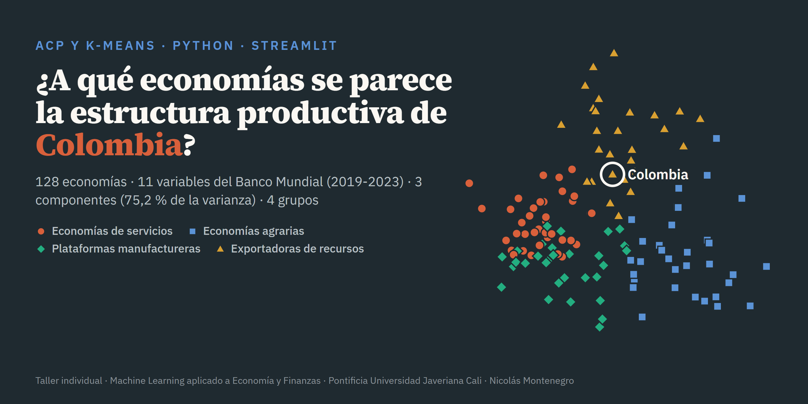
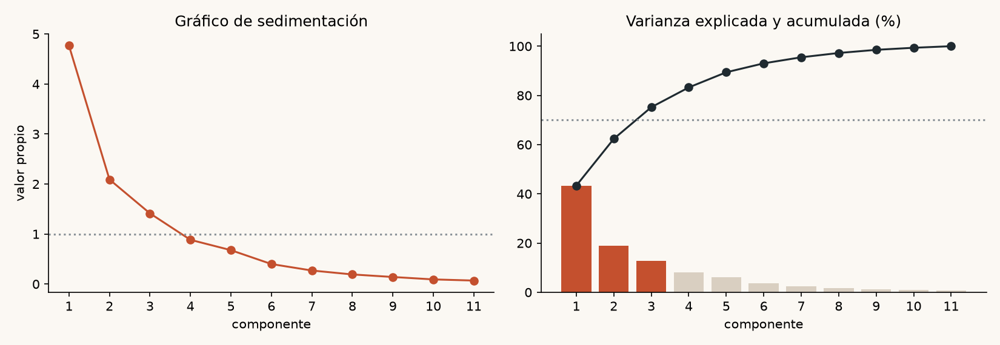
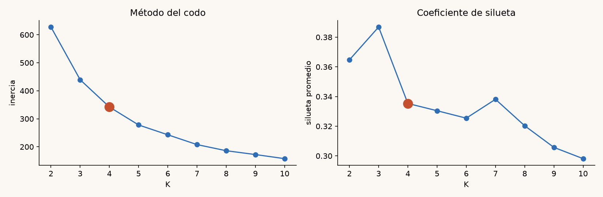
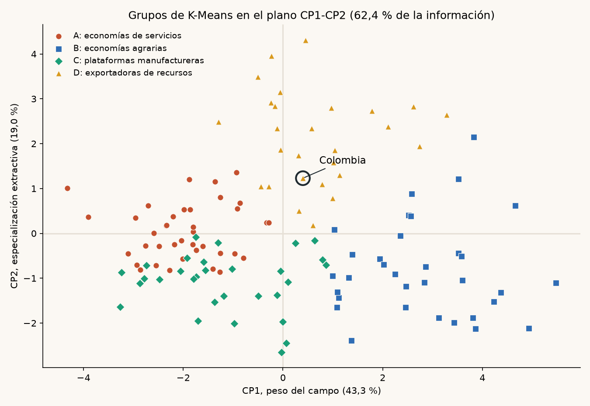

<p align="center"></p>

# ¿A qué economías se parece la estructura productiva de Colombia?

Taller individual de ACP y K-Means · Machine Learning aplicado a Economía y Finanzas · Pontificia Universidad Javeriana Cali · Nicolás Montenegro

| Entregable | Enlace |
|---|---|
| Aplicación desplegada | [acp-kmeans-colombia.streamlit.app](https://acp-kmeans-colombia.streamlit.app) |
| Video de sustentación | [youtu.be/TSV9MLfPhEQ](https://youtu.be/TSV9MLfPhEQ) |
| Repositorio | [github.com/PapiNickie/acp-kmeans-estructura-productiva](https://github.com/PapiNickie/acp-kmeans-estructura-productiva) |

## Contexto y pregunta

La economía del desarrollo describe el crecimiento como un cambio de estructura. Kuznets (1966) y Chenery y Syrquin (1975) documentaron el patrón clásico: cuando sube el ingreso, el empleo sale del campo, la manufactura gana peso y después cede espacio a los servicios. Rodrik (2016) mostró que muchos países de ingreso medio empezaron a perder manufactura con ingresos mucho más bajos que los de Europa cuando le ocurrió lo mismo, y llamó al fenómeno desindustrialización prematura.

Colombia es un caso para mirar con cuidado. Entre 2019 y 2023 los servicios generaron en promedio el 57,6 % de su PIB y la manufactura el 11,0 %, pero el 51,0 % de sus exportaciones de mercancías fueron combustibles y minerales. Por su producción se parece a una economía de servicios; por lo que vende, a una exportadora de recursos. El proyecto busca con qué países comparte estructura cuando se miran todas las dimensiones a la vez:

1. ¿Qué dimensiones comunes resumen las diferencias de estructura productiva entre países?
2. ¿Se forman grupos de economías con estructuras parecidas, y qué distingue a cada uno?
3. ¿En qué grupo queda Colombia, qué tan nítida es esa asignación y cuáles son sus vecinos más cercanos?

Cada observación es una economía (un país o territorio con datos en el Banco Mundial) y cada valor es el promedio del indicador entre 2019 y 2023.

## Datos

La fuente son los Indicadores del Desarrollo Mundial (WDI) del Banco Mundial, descargados de su API pública v2 (sin registro ni clave) con `scripts/descargar_datos.py`. El panel descargado tiene 33.809 observaciones país-indicador-año de 217 economías entre 2015 y 2024, sin agregados regionales. Los archivos están en `data/` y la descarga se puede repetir.

| Bloque | Variable del modelo | Código WDI |
|---|---|---|
| Qué produce | Agricultura, silvicultura y pesca, valor agregado (% del PIB) | NV.AGR.TOTL.ZS |
| Qué produce | Manufactura, valor agregado (% del PIB) | NV.IND.MANF.ZS |
| Qué produce | Servicios, valor agregado (% del PIB) | NV.SRV.TOTL.ZS |
| Qué produce | Rentas totales de los recursos naturales (% del PIB) | NY.GDP.TOTL.RT.ZS |
| Dónde trabaja la gente | Empleo en agricultura (% del empleo total, estimación OIT) | SL.AGR.EMPL.ZS |
| Dónde trabaja la gente | Empleo en industria (% del empleo total, estimación OIT) | SL.IND.EMPL.ZS |
| Dónde trabaja la gente | Población urbana (% del total) | SP.URB.TOTL.IN.ZS |
| Qué vende al mundo | Exportaciones de bienes y servicios (% del PIB) | NE.EXP.GNFS.ZS |
| Qué vende al mundo | Exportaciones de manufacturas (% de las de mercancías) | TX.VAL.MANF.ZS.UN |
| Qué vende al mundo | Combustibles más minerales y metales (% de las de mercancías) | TX.VAL.FUEL.ZS.UN + TX.VAL.MMTL.ZS.UN |
| Qué vende al mundo | Alta tecnología (% de las exportaciones de manufacturas) | TX.VAL.TECH.MF.ZS |

El PIB per cápita en paridad de poder adquisitivo (NY.GDP.PCAP.PP.KD) y la población (SP.POP.TOTL) no entran al modelo. La población se usa para el filtro de tamaño y el ingreso se usa al final para leer los grupos, sin haber intervenido en formarlos. La descarga incluye otras cinco variables candidatas (industria con construcción, formación bruta de capital, exportaciones de alimentos, remesas y turismo) que la aplicación permite agregar.

Limitaciones de la fuente: el empleo por sector es una estimación modelada de la OIT; la composición de las exportaciones viene de UN Comtrade y llega con rezago; todas las variables son proporciones y no dicen nada del tamaño de la economía; el promedio de cinco años es una fotografía sin trayectoria; y las cuentas nacionales miden mal la economía informal, que en Colombia ocupa a cerca del 55 % de los trabajadores según la GEIH del DANE (2025).

## Por qué ACP y K-Means

Las once variables están correlacionadas: el empleo agrícola y la agricultura en el PIB tienen una correlación de 0,86, y la población urbana de −0,77 con el empleo agrícola. Varias columnas cuentan la misma historia. El ACP resume esa redundancia en pocas dimensiones que se pueden leer como ejes de transformación estructural, y evita que en la distancia entre países las variables que se repiten pesen doble.

K-Means responde a la otra mitad de la pregunta. La literatura habla de tipos de economías (exportadoras de recursos, plataformas manufactureras, economías de servicios), pero esa etiqueta no viene en los datos. El algoritmo agrupa a los países por cercanía en el espacio de componentes sin saber nada de su región ni de su ingreso; si los grupos tienen sentido económico, la tipología tiene sustento, y si los países forman un continuo, la silueta lo va a mostrar.

## Metodología

Preparación. Se promedia cada indicador en 2019-2023 para suavizar choques de un año (2020, el precio de las materias primas en 2022). Se excluyen 57 economías con menos de un millón de habitantes, cuyas estructuras extremas arrastrarían un algoritmo de distancias. De las 160 restantes, 32 tienen algún faltante y se eliminan en lugar de imputarse: los faltantes se concentran en Estados frágiles y en países con estadísticas incompletas (Venezuela, Nigeria, Iraq), y rellenarlos inventaría estructura. Quedan 128 economías sin duplicados. Las tres variables con asimetría mayor que 2 (alta tecnología, exportaciones como % del PIB y rentas de recursos) se transforman con log(1 + x), y todas se estandarizan a media 0 y desviación 1.

ACP. Se calculan los once componentes con `sklearn.decomposition.PCA` sobre la matriz estandarizada. El criterio de Kaiser (valor propio mayor que 1) y el umbral del 70 % de varianza acumulada coinciden en tres componentes; el codo del gráfico de sedimentación aparece en dos, pero el tercer componente tiene valor propio 1,41 y una lectura económica propia. Se conservan tres.

K-Means. Se aplica `KMeans(n_clusters=K, n_init=10, random_state=42)` sobre los tres componentes, con K de 2 a 10, y se comparan la inercia (método del codo) y el coeficiente de silueta.

## Resultados principales



Tres componentes conservan el 75,2 % de la variación (43,3 %, 19,0 % y 12,8 %):

| Componente | Lectura | Cargas más altas |
|---|---|---|
| CP1, peso del campo | Economías agrarias frente a urbanas de servicios | empleo agrícola 0,89; agricultura 0,84; servicios −0,78; exportaciones de manufacturas −0,77 |
| CP2, especialización extractiva | Exportadoras de combustibles y minerales frente a exportadoras de manufacturas | combustibles y minerales 0,83; rentas 0,56; población urbana 0,55; exportaciones de manufacturas −0,50 |
| CP3, peso de la industria | Industria frente a servicios | manufactura 0,69; empleo industrial 0,63; servicios −0,54 |



La silueta es máxima con K = 3 (0,387) y baja a 0,335 con K = 4. La curva del codo no tiene un quiebre único: la inercia cae 30,0 % de 2 a 3 grupos, 22,1 % de 3 a 4, 18,8 % de 4 a 5 y 12,6 % de 5 a 6. Se eligió K = 4 porque con K = 3 un solo grupo reúne a la mitad de la muestra y mezcla a Estados Unidos y Francia con China, México y Polonia; el cuarto grupo separa a las economías de servicios de las plataformas manufactureras, que es la distinción central para hablar de desindustrialización. La aplicación permite ver la solución con K = 3.



| Grupo | Economías | Rasgos (medianas) | PIB per cápita mediano (US$ PPA 2021) | Casos |
|---|---|---|---|---|
| A, economías de servicios | 38 | servicios 66,8 % del PIB; manufacturas 64,7 % de las exportaciones | 45.875 | Estados Unidos, Reino Unido, Francia, España, Costa Rica, Uruguay |
| B, economías agrarias | 33 | empleo agrícola 47,4 %; población urbana 37,9 % | 4.009 | Etiopía, Tanzania, Uganda, India, Nepal |
| C, plataformas manufactureras | 30 | manufactura 18,4 % del PIB; empleo industrial 27,0 %; manufacturas 78,5 % de las exportaciones | 19.423 | China, Vietnam, México, Corea del Sur, Polonia |
| D, exportadoras de recursos | 27 | combustibles y minerales 65,7 % de las exportaciones; rentas 13,6 % del PIB | 19.538 | Arabia Saudita, Noruega, Australia, Chile, Perú, Colombia |

Las letras no tienen orden: A es el grupo más numeroso. El ingreso no entró al modelo y aun así se ordena (el grupo agrario tiene un PIB per cápita mediano cerca de cinco veces menor que el resto), aunque la relación no es uno a uno: las exportadoras de recursos y las plataformas manufactureras tienen ingresos medianos casi iguales y estructuras opuestas.

Los grupos no son islas. La silueta promedio de 0,335 está en la franja que Kaufman y Rousseeuw (1990) llaman estructura débil, y cuatro economías tienen silueta negativa (Brasil, Georgia, Filipinas y Sudáfrica). La lectura correcta es la de un continuo con zonas densas.

Colombia queda en el grupo D con silueta 0,279. Sus vecinos más cercanos en el espacio de componentes son Brasil, Ecuador, Armenia, Perú y Bolivia. Frente a la mediana de su grupo es una exportadora de recursos atenuada (combustibles y minerales 51,0 % frente a 65,7 %; rentas 4,1 % del PIB frente a 13,6 %) y una economía poco abierta: exporta el 16,8 % del PIB, contra una mediana muestral de 35,9 %. Su manufactura (11,0 % del PIB) pesa casi lo mismo que en la mediana de las economías de servicios (11,8 %), con un ingreso de US$ 17.489 frente a US$ 45.875: el patrón que Rodrik llama desindustrialización prematura. En las doce combinaciones de 2 a 4 componentes y K de 3 a 6, Colombia comparte grupo con Bolivia, Brasil, Panamá y Perú (y con Chile en once), y nunca con México (`resultados/robustez_colombia.csv`).

Limitaciones para usar los resultados: la muestra deja fuera por falta de datos a varias exportadoras de petróleo (Venezuela, Nigeria, Iraq, Libia, Argelia); las proporciones no miden la calidad de lo que se produce (la alta tecnología se clasifica por producto, no por valor agregado local); la fotografía 2019-2023 no distingue trayectorias; y K = 4 es una decisión de interpretación sobre una métrica que prefería K = 3. Los grupos sirven para elegir con quién compararse; no sirven para afirmar causas ni para predecir crecimiento.

## Estructura del repositorio

```
app.py                       punto de entrada de Streamlit (navegación y barra lateral)
paginas/                     una página por etapa: contexto, datos, preparación, ACP, K-Means, perfiles, discusión
src/analisis.py              procesamiento y algoritmos (corte transversal, preparación, ACP, K-Means, perfiles)
src/graficos.py              gráficos de Plotly
src/estado.py                configuración del estudio y cálculos con caché
src/estilo.py                identidad visual y componentes de interfaz
scripts/descargar_datos.py   descarga los indicadores de la API del Banco Mundial
scripts/reproducir_resultados.py  reproduce sin interfaz todas las tablas, cifras y figuras de este README
data/                        panel descargado (wdi_panel.csv) y metadatos de países (paises_meta.csv)
resultados/                  tablas, métricas y figuras generadas por el script anterior
.streamlit/config.toml       tema de la aplicación
```

La aplicación no muestra resultados fijos: cada tabla, métrica y gráfico se calcula al abrir la página a partir de `data/wdi_panel.csv`, con la configuración que el usuario elige en la barra lateral (ventana de años, tamaño mínimo, variables, logaritmo, número de componentes y K).

## Cómo ejecutarlo

Requiere Python 3.12.

```bash
git clone <url-de-este-repositorio>
cd <carpeta-del-repositorio>
pip install -r requirements.txt
streamlit run app.py
```

Para reproducir las tablas y figuras sin la interfaz:

```bash
python scripts/reproducir_resultados.py
```

Para volver a descargar los datos (tarda unos minutos porque la API limita las consultas seguidas; si la API del PIB per cápita o de la población no responde, el script usa la copia publicada por Our World in Data):

```bash
python scripts/descargar_datos.py
```

Despliegue en Streamlit Community Cloud: en share.streamlit.io, crear una aplicación desde este repositorio, rama `main`, archivo `app.py`, y elegir Python 3.12 en la configuración avanzada.

## Referencias

- Banco Mundial (2026). World Development Indicators. API v2, consultada el 14 de noviembre de 2026.
- Chenery, H. y Syrquin, M. (1975). Patterns of Development, 1950-1970. Oxford University Press.
- DANE (2025). Gran Encuesta Integrada de Hogares: informalidad laboral, trimestre octubre-diciembre de 2025.
- Kaufman, L. y Rousseeuw, P. J. (1990). Finding Groups in Data: An Introduction to Cluster Analysis. Wiley.
- Kuznets, S. (1966). Modern Economic Growth: Rate, Structure and Spread. Yale University Press.
- Rodrik, D. (2016). Premature deindustrialization. Journal of Economic Growth, 21(1), 1-33.

Los datos del Banco Mundial se publican con licencia CC BY 4.0. El código de este repositorio se publica con licencia MIT.
